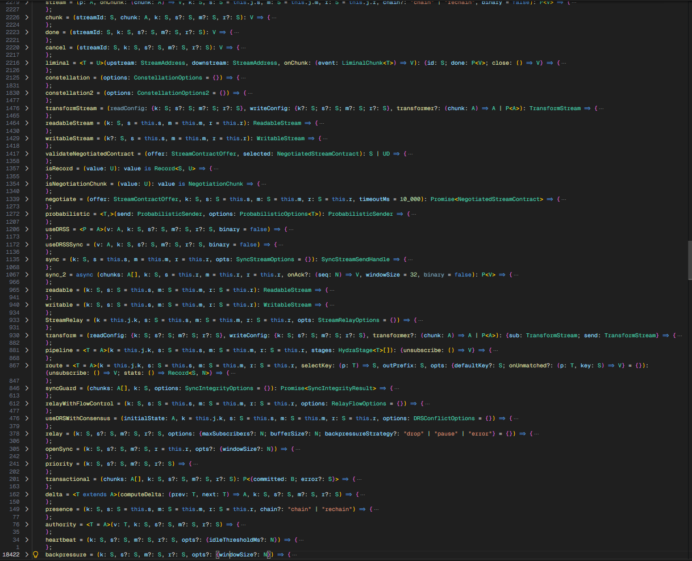

<h1>Type Alias: The Wizard's Arsenal</h1>

<em>The most opinionated platform... ever.</em>

<em>Trust me... I'm a fucking wizard... 🧙</em>

VSCode ext:

Small but powerful repos worth checking out:

The goal? To remove all friction, from everything.

 

---
 

> [!NOTE] 
>
> The goal here... remove as many key strokes as possible. The end result also included several other benefits such as compacted props defintions among others.
>
> Within 20 mins of creating this resource I had removed 250,000 characters from that app. The final tally came up to 1.2 million. It is more, but that's just when I stopped counting.

> [!IMPORTANT] 
>
> Yes, this uses globalThis. Javascript, itself, uses globalThis. Its a shame that the public opinion around this is so negative, because it is a great and powerful tool, within each devs grsps. Yet, no one uses it.
>
> No, there are no collisions. Currently I've placed it within 30+ apps, one of which is 10.3 million lines of code, with no collisions. I have also enlisted the help of several ais in getting them to find atleast a single collision in relation to any other node module... none were found.
>
> This will improve a long list of things in your day to day dev life, is there a learning? Yes, but it isn't that big of a learning curve since all alias were delibertaly and thoughtfully picked out, not randomly generated since no AI was used in the making of this library. 
>
> A = any
> S = string
>
> ... is there a learning curve? haha, yes... but its not a big one.
>
> Below I've included a screen shot of what an entire vertical space looks like with this library included.

 

 

## MaybePromise

`MaybePromisei<R>(v: R)`

If you want to learn more about this, I suggest going to its actual documentation. However, the easiest, most simpliest way to explain this to every single person without fail

### DO YOU NEED THE VALUE?
- NO? Then simply do not place an await...
- YES? Place an await infront of the fn...

| Alias | Name | Description |
|---|---|---|
| `A` | any | The `any` type. |
| `AB` | ArrayBuffer | Type and constructor for `ArrayBuffer`. |
| `AC` | AbortController | Type and constructor for `AbortController`. |
| `ADP` | AsyncDisposable | Type for `AsyncDisposable`. |
| `AE` | AggregateError | Type and constructor for `AggregateError`. |
| `AG<T, R, N>` | AsyncGenerator | Type for `AsyncGenerator<T, R, N>`. |
| `AI<T>` | AsyncIterable | Type for `AsyncIterable<T>`. |
| `AII<T>` | AsyncIterableIterator | Type for `AsyncIterableIterator<T>`. |
| `AIO<T, R, N>` | AsyncIteratorObject | Type for `AsyncIteratorObject<T, R, N>`. |
| `AO` | - | `Record<string, any>`. |
| `AOAF` | - | `AO \| AF`. |
| `AR<T>` | Array | Type and constructor for `Array<T>`. |
| `ARGS<T>` | Function Arguments | Parameter tuple of function type `T`. |
| `AS` | AbortSignal | Type and constructor for `AbortSignal`. |
| `ASF<T>` | Async Function | Function type with the same parameters as `T`, returning a `Promise` of `T`'s awaited return type. |
| `ASSERT<T extends true>` | Type Assertion | Compile-time constraint; only accepts `true`. |
| `AW<T>` | - | If `T` is `PromiseLike<U>`, resolves to `AWAIT<U>`; otherwise `T`. |
| `AWD<T>` | Awaited | Type for `Awaited<T>`. |
| `B` | boolean / Boolean | `boolean` type; `Boolean` constructor. |
| `BF` | Buffer | Type for `Buffer`. |
| `BI` | bigint / BigInt | `bigint` type; `BigInt` constructor. |
| `BL` | Blob | Type and constructor for `Blob`. |
| `BM<K, V>` | BYTEOP_MAP_TYPE | Alias of `BYTEOP_MAP_TYPE<K, V>`. |
| `BRAND<T, N>` | Branded Type | `T` with a readonly `__brand: N` property. |
| `BYTEOP_MAP_TYPE<K, V>` | - | Map-like object with `get`, `set`, `has`, `delete`, readonly `size`, and `pidToSlot: I32`. |
| `CACHE` | - | Alias of `CACHE_TYPE`. |
| `CACHE_TYPE` | - | Union of cache backend name literals (or `undefined`). |
| `CAP<T>` | Capitalize | Type for `Capitalize<T>`. |
| `CE` | CustomEvent | Type and constructor for `CustomEvent`. |
| `CHAIN` | - | `"chain" \| "rechain"`. |
| `CP<T>` | ConstructorParameters | Constructor parameter tuple of `T`. |
| `CTX<T>` | OmitThisParameter | Type for `OmitThisParameter<T>`. |
| `D` | Date | Type and constructor for `Date`. |
| `DC<T>` | Dictionary | `Record<string, T>`. |
| `DEEP<T>` | Deep | Recursive mapped type over the properties of object type `T`. |
| `DEEPP<T>` | Deep Partial | Recursively makes every property optional. |
| `DF` | DocumentFragment | Type and constructor for `DocumentFragment`. |
| `DICT<T>` | Dictionary | `{ [key: string]: T \| undefined }`. |
| `DIFF<T, U>` | Difference | Removes union members of `T` assignable to `U`. |
| `DOC` | Document | Type and constructor for `Document`. |
| `DOMX` | DOMException | Type and constructor for `DOMException`. |
| `DP` | Disposable | Type for `Disposable`. |
| `DPR<T>` | Deep Readonly | Recursively makes every property readonly (references `DEEPR`). |
| `dURI(s)` | decode URI | Function declared as `(decodedURI: string) => string`. |
| `DV` | DataView | Type and constructor for `DataView`. |
| `E` | Error | Type and constructor for `Error`. |
| `EC<T>` | Error Cause | `Error` with an optional `cause: T`. |
| `EL` | Element | Type and constructor for `Element`. |
| `eURI(s)` | encode URI | Function declared as `(encodedURI: string) => string`. |
| `EV` | Event | Type and constructor for `Event`. |
| `EX<T, U>` | Exclude | Type for `Exclude<T, U>`. |
| `EQ<X, Y>` | Type Equality | `true` if `X` and `Y` are exactly equal, otherwise `false`. |
| `esc(s)` | escape | Function declared as `(string: string) => string`. |
| `EXT<T>` | Extract Array Type | Element type of array `T`; otherwise `never`. |
| `F<T>` | Function | `Function \| (() => T)`. Value `F` is `FunctionConstructor`. |
| `F32` | Float32Array | Type and constructor for `Float32Array`. |
| `F64` | Float64Array | Type and constructor for `Float64Array`. |
| `FD` | FormData | Type and constructor for `FormData`. |
| `FIRST<T>` | First Element | First element type of tuple `T`. |
| `FL` | File | Type and constructor for `File`. |
| `FLR` | FileReader | Type and constructor for `FileReader`. |
| `FN<T>` | Function | Function type `T`, defaulting to `(...args: any) => any`. |
| `FR<T>` | FinalizationRegistry | Type for `FinalizationRegistry<T>`; value is its constructor. |
| `FREG<T>` | Finalization Registry | `FinalizationRegistry<T>` where `T extends Object`. |
| `FS` | FileSystem | Type for `FileSystem`; value is `{ prototype: FileSystem }`. |
| `GEN<T, R, N>` | Generator | Type for `Generator<T, R, N>`. |
| `GUARD<T, U>` | Type Guard | `T` if assignable to `U`; otherwise `never`. |
| `HE` | HTMLElement | Type and constructor for `HTMLElement`. |
| `I<T>` | Iterable | Type for `Iterable<T>`. |
| `I8` | Int8Array | Type and constructor for `Int8Array`. |
| `I16` | Int16Array | Type and constructor for `Int16Array`. |
| `I32` | Int32Array | Type and constructor for `Int32Array`. |
| `IA<T>` | Is Any | `true` if `T` is `any`, otherwise `false`. |
| `ICT<T>` | Instance Type | Instance type produced by constructor `T`. |
| `IDX<T>` | Indexed Element Type | Element type of a readonly or mutable array. |
| `IN<T, U>` | Include / Extract | Type for `Extract<T, U>`. |
| `INE<T>` | Is Never | `true` if `T` is exactly `never`. |
| `INF` | Infinity | Value of type `number`. |
| `INST<T>` | Instance | `InstanceType` of constructable type `T`. |
| `IO<T, R, N>` | IteratorObject | Type for `IteratorObject<T, R, N>`. |
| `IT<T>` | Iterator | Type for `Iterator<T>`. |
| `ITI<T>` | IterableIterator | Type for `IterableIterator<T>`. |
| `ITO` | IntersectionObserver | Type and constructor for `IntersectionObserver`. |
| `IU<T>` | Is Unknown | `true` if `T` is exactly `unknown`. |
| `IUN<T>` | Is Union | Whether `T` contains multiple distinct union members. |
| `J` | JSON | Type and value for `JSON`. |
| `JOIN<T, D>` | String Join | Joins a tuple of string literals with delimiter `D`. |
| `JP` | JSON.parse | `JSON.parse` (value is the function). |
| `JS` | JSON.stringify | `JSON.stringify` (value is the function). |
| `K<T>` | keyof | Type for `keyof T`. |
| `KE` | KeyboardEvent | Type and constructor for `KeyboardEvent`. |
| `KEYS<T>` | Keys | Type for `keyof T`. |
| `LAST<T>` | Last Element | Last element type of tuple `T`. |
| `LENGTH<T>` | Tuple Length | `T["length"]` of a tuple. |
| `LOWER<T>` | Lowercase | Type for `Lowercase<T>`. |
| `M<K, V>` | Map | Type for `Map<K, V>`; value is `Map`. |
| `MB<T>` | Maybe | `T \| null \| undefined`. |
| `MC` | MessageChannel | Type and constructor for `MessageChannel`. |
| `MCL` | Math.ceil | `Math.ceil` (value is the function). |
| `ME` | MouseEvent | Type and constructor for `MouseEvent`. |
| `MF` | Math.floor | `Math.floor` (value is the function). |
| `MN` | Math.min | `Math.min` (value is the function). |
| `MO` | MutationObserver | Type and constructor for `MutationObserver`. |
| `MP` | MessagePort | Type and constructor for `MessagePort`. |
| `MR` | Math.round | `Math.round` (value is the function). |
| `MT` | Math.trunc | `Math.trunc` (value is the function). |
| `MUT<T>` | Mutable | Removes `readonly` from all properties of `T`. |
| `MX` | Math.max | `Math.max` (value is the function). |
| `MaybePromise<R>` | MaybePromise | Type alias of `R`. Value `MaybePromise` is `MaybePromisei`. |
| `N` | number / Number | `number` type; `Number` constructor. |
| `NaN` | NaN | Value of type `number`. |
| `NB` | bigint | `bigint`. |
| `ND` | Node | Type and constructor for `Node`. |
| `NE` | never | The `never` type. |
| `NI<T>` | NoInfer | Type for `NoInfer<T>`. |
| `NIL<T>` | - | `T \| null`. |
| `NL<T>` | NodeListOf | Type for `NodeListOf<T>`; value is `NodeList`. |
| `NLE` | NodeListOf<Element> | `NodeListOf<Element>`. |
| `NNM` | NamedNodeMap | Type and constructor for `NamedNodeMap`. |
| `NONEMPTY<T>` | Non-empty Tuple | `readonly [T, ...T[]]`. |
| `NR<T>` | NonNullable | Type for `NonNullable<T>`. |
| `NU` | null | The `null` type. |
| `O` | Object | Type for `Object`; value is `ObjectConstructor`. |
| `OA` | Object.assign | `Object.assign` (value is the function). |
| `OB<T>` | - | `{ [key: string]: T }`. |
| `OBJ<T>` | - | `{ [key: string]: T }`. |
| `OE` | Object.entries | `Object.entries` (value is the function). |
| `OF` | Object.freeze | `Object.freeze` (value is the function). |
| `OI` | Object.is | `Object.is` (value is the function). |
| `OK` | Object.keys | `Object.keys` (value is the function). |
| `OM<T, K>` | Omit | Type for `Omit<T, K>`. |
| `OO<T, U>` | - | `Omit<T, keyof U> & U`. |
| `OPT<T>` | Optional Value | `T \| undefined`. |
| `OTT<T>` | OmitThisParameter | Type for `OmitThisParameter<T>`. |
| `OV` | Object.values | `Object.values` (value is the function). |
| `P<T>` | Promise | Type for `Promise<T>`; value is `PromiseConstructor`. |
| `PA<T>` | Partial | Type for `Partial<T>`. |
| `PARAMS<T>` | Parameters | Parameter tuple of function type `T`. |
| `PE` | PointerEvent | Type and constructor for `PointerEvent`. |
| `PFR<T>` | PromiseFulfilledResult | Type for `PromiseFulfilledResult<T>`. |
| `PI<T, K>` | Pick | Type for `Pick<T, K>`. |
| `PK` | PropertyKey | Type for `PropertyKey`. |
| `PL<T>` | PromiseLike | Type for `PromiseLike<T>`. |
| `PO` | PerformanceObserver | Type and constructor for `PerformanceObserver`. |
| `PRR` | PromiseRejectedResult | Type for `PromiseRejectedResult`. |
| `PSR<T>` | PromiseSettledResult | Type for `PromiseSettledResult<T>`. |
| `PX<T>` | Proxy | Type: `T extends object`, resolves to `T`. Value is `ProxyConstructor`. |
| `pFloat(s)` | parseFloat | Function declared as `(string: string) => number`. |
| `pInt(s, radix?)` | parseInt | Function declared as `(string: string, radix?: number) => number`. |
| `R<K, V>` | Record | Type for `Record<K, V>`. |
| `RA` | Range | Type and constructor for `Range`. |
| `RE` | RangeError | Type and constructor for `RangeError`. |
| `REG` | RegExp | Type and constructor for `RegExp`. |
| `REPLACE<S0, F, T>` | String Replace | Replaces the first match of `F` with `T` in a string literal. |
| `REQ<T>` | Required | Type for `Required<T>`. |
| `RET<T>` | ReturnType | Type for `ReturnType<T>`. |
| `RFE` | ReferenceError | Type and constructor for `ReferenceError`. |
| `RM<K, V>` | ReadonlyMap | Type for `ReadonlyMap<K, V>`. |
| `RND` | Math.random | `Math.random` (value is the function). |
| `RO<T>` | Readonly | Type for `Readonly<T>`. |
| `ROA<T>` | ReadonlyArray | `ReadonlyArray` of `T[number]`. |
| `ROARR<T>` | Readonly Array | `readonly T[]`. |
| `ROBJ<T>` | Readonly Object | Makes every property of `T` readonly. |
| `RS<T>` | ReadonlySet | Type for `ReadonlySet<T>`. |
| `RSO` | ResizeObserver | Type and constructor for `ResizeObserver`. |
| `RT<T>` | ReturnType | Type for `ReturnType<T>`. |
| `S` | string / String | `string` type; `String` constructor. |
| `SB` | - | `` `${boolean}` `` (`"true" \| "false"`). |
| `SBI` | - | `` `${bigint}` ``. |
| `SE` | SyntaxError | Type and constructor for `SyntaxError`. |
| `SK` | - | `` `${string & {}}` `` (also declared as `SK<T>` below). |
| `SK<T>` | String Keys | `keyof T & string`. |
| `SN` | - | `` `${number}` ``. |
| `SPLIT<S0, D>` | String Split | Splits a string literal into a tuple by delimiter `D`. |
| `ST<T>` | Set | Type for `Set<T>`; value is `Set`. |
| `STR<T>` | String Type | `T` if assignable to `string`; otherwise `never`. |
| `SU` | - | `string \| undefined`. |
| `SY` | symbol / Symbol | `symbol` type; `Symbol` constructor. |
| `TD` | TextDecoder | Type `TextDecoder`; value is a `TextDecoder` instance. |
| `TE` | TextEncoder | Type `TextEncoder`; value is a `TextEncoder` instance. |
| `TL<T>` | Template Length | `T["length"]` of a string type. |
| `TT<T>` | ThisParameterType | Type for `ThisParameterType<T>`. |
| `TUP<T>` | Tuple | `[...T]`. |
| `TW` | TreeWalker | Type and constructor for `TreeWalker`. |
| `TYE` | TypeError | Type and constructor for `TypeError`. |
| `U` | unknown | The `unknown` type. |
| `U8` | Uint8Array | Type and constructor for `Uint8Array`. |
| `U8C` | Uint8ClampedArray | Type and constructor for `Uint8ClampedArray`. |
| `U16` | Uint16Array | Type and constructor for `Uint16Array`. |
| `U32` | Uint32Array | Type and constructor for `Uint32Array`. |
| `U32ARB` | - | `Uint32Array<ArrayBufferLike>`. |
| `UD` | undefined | The `undefined` type. |
| `UE` | URIError | Type and constructor for `URIError`. |
| `UF<T>` | - | `T \| (() => T)`. Value: returns the result of calling `v` if it is a function, otherwise `v`. |
| `UFA<T>` | - | `T \| Promise<T> \| (() => T \| Promise<T>)`. Value: async; resolves to the awaited value or factory result. |
| `UFD<T>` | - | `T \| undefined`. Value `(v, d)`: returns `UF(d)` if `v` is `undefined`, otherwise `v`. |
| `UFM<T>` | - | `T \| null \| undefined`. Value `(v, d)`: returns `UF(d)` if `v` is `null` or `undefined`, otherwise `v`. |
| `UFO<T>` | - | `UF<T> \| undefined`. Value: returns `undefined` if `v` is `undefined`, otherwise `UF(v)`. |
| `UFP<T>` | - | `T \| Promise<T>`. Value: `Promise.resolve(v)`. |
| `UFU<T>` | - | `T \| ((old: T) => T)`. Value `(v, old)`: calls `v(old)` if `v` is a function, otherwise `v`. |
| `UNC<T>` | Uncapitalize | Type for `Uncapitalize<T>`. |
| `UNION<T>` | Union | Distributes over a union and retains its members. |
| `UPC<T>` | Uppercase | Type for `Uppercase<T>`. |
| `URI` | URL | Alias of `URL`. |
| `URL` | URL | Type and constructor for `URL`. |
| `URLP` | URLPattern | Type and constructor for `URLPattern`. |
| `unesc(s)` | unescape | Function declared as `(string: string) => string`. |
| `V` | void | The `void` type. |
| `VAL<T>` | Values | Union of the property value types of `T`. |
| `VALOF<T>` | Value Of | Union of the property value types of `T`. |
| `W` | Worker | Type and constructor for `Worker`. |
| `WC` | - | The literal `"*"`. |
| `WEAKMAP<K, V>` | WeakMap | Type for `WeakMap<K, V>`. |
| `WIN` | Window | Type for `Window`. |
| `WM<K, V>` | WeakMap | Type for `WeakMap<K, V>`; value is `WeakMap`. |
| `WR<T>` | WeakRef | Type for `WeakRef<T>`; value is `WeakRef`. |
| `WS` | WebSocket | Type and constructor for `WebSocket`. |
| `WST<T>` | WeakSet | Type for `WeakSet<T>`; value is `WeakSet`. |
| `XOR<T, U>` | - | Exclusive-or of two object types. |
| `XS` | any | `any`. |
